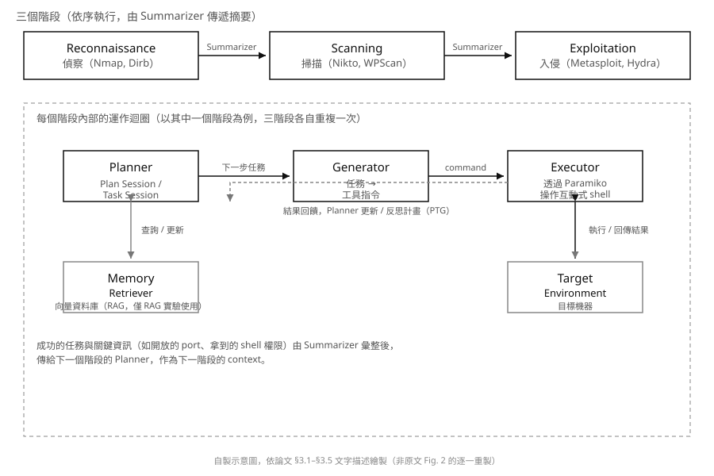
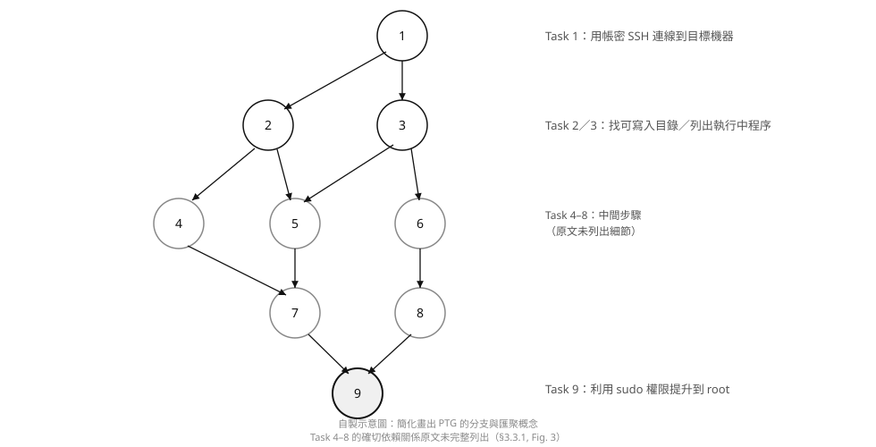

## 一句話摘要

VulnBot 把滲透測試拆成「偵察→掃描→入侵」三個專職階段，分別交給不同角色的 LLM 代理人負責，並用「滲透任務圖」（PTG）規劃任務執行順序、用 Summarizer 在階段之間傳遞摘要；在 AUTOPENBENCH 上，VulnBot 搭配開源的 Llama3.1-405B 整體完成率達 30.30%，優於 GPT-4o 的 21.21% 與原始 Llama3.1-405B 的 9.09%（Table 2），搭配 RAG 後更在一台真實機器上做到完整的端對端自動滲透（§5.4）。

## 1. 問題與動機

**背景：** 滲透測試（penetration testing，模擬攻擊者手法去找系統漏洞，又稱 ethical hacking）依 OWASP 測試指南分成偵察、掃描、漏洞利用、維持存取、報告五個階段（§2.1）。整個流程平均要花約 10 天，其中偵察階段最耗時，通常占 4 到 6 天（§2.1）；費用方面，基本的網站掃描約 349 至 1499 美元，較完整的 SaaS／網頁應用評估可達 700 至 5999 美元（§2.1）。因為耗時又昂貴，業界需要更有效率的自動化方法。

- **LLM 助理型工具仍需要人力頻繁介入。** 像 PentestGPT 這類工具會由人類不斷確認、補充資訊才能往下走，自主性有限（§1, Fig. 1(a)）。PentestGPT 雖然用推理、生成、解析三個模組解決了 LLM 容易斷脈絡的問題，但仍大量依賴人工介入，且無法衡量介入程度（§1）。
- **純自動化代理人會被資訊量淹沒。** 這類系統把所有掃描結果直接丟給 LLM，容易因為資訊過多而脈絡遺失，進而導致下一步指令執行失敗（§1, §2.2, Fig. 1(b)）。AutoAttacker 雖然示範了用 LLM 搭配 Metasploit 自動執行「入侵後」階段的攻擊，但主要針對特定任務，不是完整的真實環境流程（§1）。
- **作者先做了一個探索性研究確認問題所在。** 用 Llama3.3-70B 與 Llama3.1-405B 在 AUTOPENBENCH 上共跑了 220 次實驗，統計失敗原因（Table 1）：整體最大的失敗原因是「Session Context Loss」（對話脈絡遺失），占 42.36%（Table 1），其次是「Failed Tool」（工具執行失敗，19.70%）與「Failed Command Param」（指令參數錯誤，19.21%）（Table 1）。偵察階段最常見的問題是模型沒聽懂使用者一開始的描述，例如不會執行類似 `nmap -p 10.10.1.x` 的完整連接埠掃描；入侵階段則常常忘記前面階段已經掃描過的目標或資訊（§2.2.2）。
- 由此歸納出四個挑戰（Takeaway 1–4，§2.3），也是 VulnBot 設計的出發點：
    - **Takeaway 1（Context 長度有限）：** LLM 的 context window 是固定的，進展到後面階段常常忘記前面找到的東西。
    - **Takeaway 2（指令生成不準確）：** LLM 容易生成錯誤的工具用法，或捏造不存在的參數。
    - **Takeaway 3（缺乏錯誤處理機制）：** 指令執行失敗時，模型無法自己診斷、修正，通常得靠人工介入才能繼續。
    - **Takeaway 4（跨階段動態推理困難）：** 偵察、掃描、入侵環環相扣，掃描階段發現的線索必須能傳遞給入侵階段用來擬定策略，但現有系統常常只能在單一階段內表現好，跨階段串接仍需要人工協助。

## 2. 貢獻

- **三階段角色分工架構：** 把滲透測試拆成偵察、掃描、入侵三個專職階段，分別交給配備不同工具的 LLM 代理人負責，而不是用一個模組硬撐全部五個傳統階段，藉此減少跨階段的資訊遺失，對應 Takeaway 1、4（§1, §3.2）。
- **以滲透任務圖（PTG）為核心的任務驅動機制：** 把任務與其依賴關係建模成有向無環圖，確保任務依序、無衝突地執行；再搭配「檢查與反思機制」，依任務成功或失敗的回饋動態修改計畫，對應 Takeaway 2、3（§1, §3.3）。
- **用開源模型證明可行性：** VulnBot 全程使用 Llama3.3-70B、Llama3.1-405B、DeepSeek-V3 等開源模型，不依賴 GPT-4，在 AUTOPENBENCH 上整體完成率 30.3%、子任務完成率 69.05%（Table 2, 3），並在 AI-Pentest-Benchmark 的 6 台真實機器上取得最佳表現；搭配 RAG 後能完整端對端滲透一台真實機器（§1, §5.3, §5.4）。

## 3. 方法

VulnBot 由五個模組組成：Planner（規劃）、Memory Retriever（記憶檢索）、Generator（指令生成）、Executor（執行）、Summarizer（摘要），共同驅動偵察、掃描、入侵三個階段依序執行（§3.1）。



**怎麼看這張圖：** 上排三個方框是依序執行的三個階段，方框之間的箭頭代表 Summarizer 把上一階段的重點摘要傳給下一階段。下方虛線框放大呈現「單一階段內部」的運作方式（三個階段都用同一套機制，只是工具與目標不同）：Planner 決定下一步任務後交給 Generator 轉成具體指令，Generator 把指令交給 Executor 在目標機器上執行，執行結果再回饋給 Planner 更新或反思整個任務計畫；Planner 左下方的 Memory Retriever 只在搭配 RAG 的實驗中用來查詢過去的滲透知識。

### 角色分工（Role Specialization）

VulnBot 沒有照搬 OWASP 的五階段流程，而是重新切成三個階段，各自配備不同工具，為的是讓每個階段只需要記住自己需要的資訊，降低 Takeaway 1 提到的 context 遺失問題（§3.2）：

- **Reconnaissance（偵察）：** 目標是找出目標系統開了哪些連接埠與服務，使用 Nmap（連接埠掃描）與 Dirb（網站目錄探測）等工具（§3.2）。
- **Scanning（掃描）：** 根據偵察結果進一步檢查弱點與錯誤設定，使用 Nikto（網頁伺服器弱點掃描）與 WPScan（WordPress 網站弱點掃描）（§3.2）。
- **Exploitation（入侵）：** 利用前兩階段找到的漏洞實際取得存取權並提升權限，使用 Metasploit（開發與執行攻擊程式的框架）與 Hydra（密碼暴力破解工具）（§3.2）。

每個代理人收到的任務指示是一段文字，裡面包含任務描述、一段「角色扮演」式的提示技巧，以及代理人的基本設定（§3.2）。[補充] 論文提到這段角色扮演提示的目的是降低 LLM 因安全政策而拒絕回答滲透測試相關問題的機率（文中稱為 role-playing jailbreak method），但沒有進一步討論其倫理疑慮；本筆記不重現相關提示內容。

### 滲透路徑規劃（Planner + Memory Retriever）

Planner 模組負責產生並維護整份滲透測試計畫，內部分成兩種 session（§3.3）：

- **Plan Session：** 依使用者需求與目標系統特性，產生一份 JSON 格式的任務清單（每個任務有唯一 ID、依賴關係、指令說明、動作類型），目的是建構「滲透任務圖」（Penetration Task Graph, PTG）——一個描述任務先後順序的有向無環圖（§3.3，Definition 1）。這份計畫會隨著任務執行結果動態更新。
- **Task Session：** 把 Plan Session 給的每個任務拆成具體細節，交給 Generator 執行，並負責檢查任務執行結果是否成功（§3.3）。

論文用一個例子示範 PTG 如何串接任務：Task 1 是用帳號密碼透過 SSH 連線到目標機器（IP 192.168.1.104、連接埠 22）；Task 2（找可寫入的目錄）與 Task 3（列出執行中的程序）都依賴 Task 1 先完成；最後 Task 9 則是利用找到的 sudo 權限提升到 root（§3.3.1, Fig. 3）。



**怎麼看這張圖：** 每個圓圈是一個任務節點，箭頭代表「前面的任務要先完成，後面的任務才能開始」的依賴關係。最上方的 Task 1 分支出 Task 2、3；中間的 Task 4 到 8 原文只用「……」省略細節，這裡只畫出一般 PTG 會有的分支再匯聚的概念，不代表原文圖 3 的精確連線；最下方的 Task 9（灰底）則是整個任務鏈匯聚後的最終目標：取得 root 權限。

為了處理「有任務失敗該怎麼辦」的問題（對應 Takeaway 3），VulnBot 加入**檢查與反思機制**（Check and Reflection Mechanism）：Task Session 先判斷任務是否成功，Plan Session 再根據成功與失敗的回饋更新 prompt 並修訂計畫——成功的任務留在計畫裡，失敗的任務被標記為需要重新分析（§3.3.2）。更新計畫時使用 **Merge Plan Algorithm**（Algorithm 1）：先把舊計畫中「已完成、但新計畫沒列出」的任務原封不動加進合併後的計畫；再逐一處理新產生的任務，如果該任務在已完成清單中已存在，就更新它的順序與依賴關係，否則就當成全新任務插入（§3.3.2, Algorithm 1）。這確保計畫在反覆修訂時不會遺失已經做完的工作。

另外，為了降低 LLM 常見的幻覺（hallucination，模型生出看似合理但其實不存在或不正確的內容）問題，VulnBot 用第三方 RAG（Retrieval-Augmented Generation，先從資料庫檢索相關內容再交給 LLM 生成回應）框架 Langchain-Chatchat 實作 Memory Retriever 模組：把過去成功的任務與滲透知識存成向量資料庫，產生或更新計畫時，將目前計畫轉成向量，和資料庫做相似度比對，取出最相似的候選後再用重排序（re-ranking）演算法挑出最適合的（§3.3）。

### 代理人間溝通（Summarizer）

三個階段之間並不是直接把所有原始資料丟給下一階段，而是由 Summarizer 模組整理成精簡的自然語言摘要（§3.4）：

- 偵察階段結束後，Summarizer 會彙整開放的連接埠、服務 banner（服務回應時透露的版本資訊）、作業系統指紋、軟體版本等重點，傳給掃描階段的 Planner（§3.4）。
- 掃描階段若發現網頁應用的漏洞，Summarizer 會特別標示出來，讓入侵階段能優先針對這個弱點規劃攻擊（§3.4）。
- Summarizer 也會記錄目前的 shell 狀態（例如已經用攻擊機 Kali Linux 取得目標機器上某個低權限帳號的存取權），讓之後的階段可以接續這個狀態繼續規劃，而不用重新取得存取權（§3.4）。

這個設計是為了在精簡資訊、節省 token 的同時，避免像 Takeaway 1、4 所說的「資訊過多反而遺失重點」或「跨階段斷鏈」的問題（§3.4）。

### 生成式滲透行為與互動（Generator + Executor）

VulnBot 提供三種操作模式，但論文的實驗評估只使用自動模式，因為人工涉入會帶來難以量化的主觀變異（§3.5）：

- **Automatic（自動）：** 全程不需要人工介入，本論文的實驗都採用這個模式（§3.5）。
- **Manual（人工）：** 由使用者親自執行指令並回報結果，適合需要人判斷複雜或模糊輸出的情境（§3.5）。
- **Semi-Automatic（半自動）：** 依任務的動作類型決定——標記為 shell 指令的自動執行，標記為 manual 的交給使用者執行（§3.5）。

**Generator** 把 Planner 給的抽象任務轉換成特定工具的具體指令，例如把「列舉開放的連接埠」轉換成 `nmap -sV -p 22,80 <target-ip>` 這樣的實際指令（§3.5）。**Executor** 則透過 Python 的 Paramiko 函式庫，和攻擊機（Kali Linux）維持一個互動式 shell，模擬人類鍵盤操作來執行這些指令，並把結果回傳給 Planner（§3.5）。為了避免執行結果過長而淹沒 context，系統設有過濾機制：若任務執行結果超過 8000 個字元，就先用 LLM 萃取重點後再往下傳，降低資訊過載的風險（§3.5）。

## 4. 實驗

### 設定

- **Benchmark 一：AUTOPENBENCH。** 涵蓋 33 個任務，分成 Access Control（AC）、Web Security（WS）、Network Security（NS）、Cryptography（CRPT）、Real-world 五類，其中 Real-world 類別包含兩個基於真實 CVE 的任務（§2.2.2, §5.1, §6.2）。
- **Benchmark 二：AI-Pentest-Benchmark。** 由 Vulnhub 上 13 台真實可滲透的漏洞機器組成，論文挑選其中 6 台做評估，聚焦在不需要圖片觀察、也不需要人工介入的任務（§2.2.2, §5.3）。
- **比較對象：** GPT-4o（gpt-4o-2024-08-06）、Llama3.3-70B、Llama3.1-405B 的原始（Base）版本，以及把這些模型接到 PentestGPT 上的版本；真實機器實驗再加入 DeepSeek-v3（§5.1, §5.3）。GPT-4o 的數據引用自 AUTOPENBENCH 論文本身（§5.1）。
- **關鍵參數：** LLM 溫度設為 0.5；AUTOPENBENCH 任務步數上限 15 步（每階段最多 5 步），AI-Pentest-Benchmark 步數上限 24 步（每階段最多 8 步），GPT-4o 的步數上限則分別是 in-vitro 任務 30 步、real-world 任務 60 步（§4.1）。Llama3.3-70B 與 Llama3.1-405B 使用 128k token 的 context，DeepSeek-v3 使用 64k token（§4.1）。
- **指標：** 整體任務完成率（overall completion rate，一個任務的所有子任務都要通過才算完成）與子任務完成率（subtask completion rate）；子任務完成率又分成「1 Experiment」（五次實驗中只要有一次成功就算完成）與「5 Experiments」（五次全部都要成功）兩種算法（§5.1）。

### 結果

- **整體完成率：** VulnBot-Llama3.1-405B 在 AUTOPENBENCH 上整體完成率達 30.30%（10/33），高於 GPT-4o 的 21.21%（7/33），也遠高於原始 Llama3.1-405B 的 9.09%（3/33）（Table 2）。VulnBot-Llama3.3-70B 也達到 18.18%（6/33），優於原始 Llama3.3-70B 的 6.06%（2/33）（Table 2）。
- **子任務完成率：** 以「1 Experiment」計算，VulnBot-Llama3.1-405B 達 69.05%，高於原始 Llama3.1-405B 的 49.05%、以及接 PentestGPT 版本的 40.00%（Table 3）。VulnBot-Llama3.3-70B 為 59.52%，同樣高於原始版本的 44.76%（Table 3）。
- **各階段失敗次數：** 在偵察與掃描這兩個早期階段，VulnBot-Llama3.1-405B 的失敗次數明顯較少——偵察只失敗 9 次（原始版本是 71 次）、掃描失敗 32 次（原始版本 47 次），顯示早期階段執行得更穩定（Fig. 4）。但入侵階段的失敗次數反而比原始版本高：VulnBot-Llama3.1-405B 失敗 105 次（原始版本 40 次），VulnBot-Llama3.3-70B 失敗 93 次（原始版本 58 次）（Fig. 4）。最終能推進到「完成」（Finish）階段的任務數，VulnBot-Llama3.1-405B 有 19 個，遠高於原始版本的 7 個（Fig. 4）。[補充] 入侵階段失敗次數不減反增，可能是因為前面階段更穩定地往後推進，讓更多任務真的走到了複雜的入侵步驟，才暴露出更多失敗，而不是入侵本身的機制變差。
- **消融實驗（Ablation）：** 針對 AUTOPENBENCH 的 Real-world 任務、使用 Llama3.1-405B，完整版 VulnBot 的子任務成功數是 55；拿掉角色分工後掉到 32，拿掉 PTG 掉到 37，拿掉 Summarizer 掉到最低的 27（Fig. 5, §5.2）。三個變體的整體任務成功數都變成 0，而完整版 VulnBot 原本能完成 3 個整體任務（Fig. 5, §5.2）。[補充] 三個元件中拿掉 Summarizer 的影響最大（55 降到 27），顯示論文真正解決的核心痛點比較偏向「跨階段資訊傳遞」，PTG 被拿掉後的降幅（55 降到 37）相對較小。
- **真實機器（AI-Pentest-Benchmark）：** 在 6 台真實機器中，VulnBot-Llama3.1-405B 在 Victim1（0.33）、Library2（0.40）、WestWild（0.57）上取得最高的子任務完成率（Fig. 6, §5.3）；VulnBot-DeepSeek-v3 則在 Victim1 達到 0.83、WestWild 達到 0.71（Fig. 6, §5.3）。
- **搭配 RAG（Memory Retriever）：** 把 Memory Retriever 接上 Llama3.1-405B 後，在 WestWild 機器上的完成率達到 1.00，代表這台機器被完整端對端滲透成功（Fig. 7, §5.4）；在 Victim1 上也達到 0.83，高於 GPT-4o 人工操作的 0.33 與 Llama3.1-405B 人工操作的 0.67（Fig. 7, §5.4）。

## 5. 限制

### 作者自述

- **無法處理非文字資訊：** VulnBot 目前無法分析滲透測試工具產生的圖片或圖形介面輸出，只能依賴人工描述，這是邁向完全自動化的一個瓶頸（§6.1）。
- **真實世界端對端滲透仍然困難：** 即使搭配 RAG 增強知識，VulnBot 在真實機器上要完整走完所有階段仍然不容易，原因包括真實系統的複雜度、漏洞的動態變化，以及需要精確執行多步驟攻擊鏈（§6.2）。作者也提到 AUTOPENBENCH 的真實世界任務包含兩個 2024 年才揭露的 CVE，VulnBot 用知識截止於 2023 年 12 月的 Llama3.3、Llama3.1 完成了其中一個，顯示系統的表現不完全依賴模型是否「背過」這個漏洞（§6.2）。

### 我的觀察

- [補充] 消融實驗顯示拿掉 Summarizer 的影響（55→27）大於拿掉 PTG（55→37）或角色分工（55→32）（Fig. 5），代表「跨階段摘要傳遞」可能是這篇論文設計中最關鍵的一環，但正文對此的討論篇幅不如 PTG 多，值得在引用時特別留意。
- [補充] 入侵（Exploitation）階段的失敗次數在 VulnBot 版本反而比原始版本高（Fig. 4），說明三階段拆分主要緩解的是「前期資訊遺失」的問題，對於入侵階段本身需要的複雜鏈式操作（例如多步驟提權）幫助有限，這點和作者在 §6.2 提到真實世界挑戰的說法互相呼應。
- [補充] 論文提到用「角色扮演」提示技巧降低 LLM 拒答的機率（§3.2），但沒有說明這類提示在面對一般商用 LLM 服務的安全防護機制時是否仍然有效、或是否會被平台偵測，這部分留給之後想重現或改良本系統的人需要額外評估。
- [補充] 比較基準中 GPT-4o 的數據是直接引用自 AUTOPENBENCH 論文（§5.1），而非作者自己重跑，實驗環境、版本或隨機性是否完全一致沒有進一步說明，解讀跨論文比較的數字時宜保守一些。

## 7. 關鍵名詞

| 術語 | 說明 |
|---|---|
| Penetration Task Graph（PTG，滲透任務圖） | 用有向無環圖表示滲透測試任務與其依賴關係，確保任務依序、無衝突地執行，並追蹤每個任務的完成與成功狀態（§3.3.1）。 |
| Planner | 負責產生與維護整份滲透測試計畫的模組，分 Plan Session（產生／更新 PTG）與 Task Session（產生任務細節、檢查執行結果）兩種 session（§3.3）。 |
| Summarizer | 跨階段的溝通橋樑，把上一階段的關鍵結果（如開放的連接埠、找到的弱點）整理成自然語言摘要傳給下一階段，並記錄目前的 shell 狀態（§3.4）。 |
| Generator | 把 Planner 給出的下一步任務轉換成特定工具的具體指令，例如把「掃描開放連接埠」轉成 nmap 指令（§3.5）。 |
| Executor | 透過 Python 的 Paramiko 函式庫維持與攻擊機（Kali Linux）的互動式 shell，執行 Generator 產生的指令並回傳結果（§3.5）。 |
| Memory Retriever | 以 RAG 方式用向量資料庫儲存過去成功任務與滲透知識，在生成或更新計畫時檢索最相似的經驗來輔助決策，僅在 RAG 相關實驗中使用（§3.3, §5.4）。 |
| Merge Plan Algorithm | 把新產生的任務清單與舊的已完成任務合併，保留已完成任務及其依賴關係，用於檢查與反思機制中更新計畫（Algorithm 1, §3.3.2）。 |
| AUTOPENBENCH | 涵蓋 33 個任務（含模擬情境與真實 CVE）的滲透測試評測基準，分 Access Control、Web Security、Network Security、Cryptography、Real-world 五類（§2.2.2）。 |
| AI-Pentest-Benchmark | 由 Vulnhub 上 13 台真實可滲透機器組成的評測基準，用於評估系統在真實環境中的表現（§2.2.2）。 |
| RAG（Retrieval-Augmented Generation） | 先從資料庫檢索相關內容，再連同問題一起交給 LLM 生成回應，用來降低 LLM 的幻覺問題（§3.3）。 |

## 8. BibTeX

```bibtex
@article{kong2025vulnbot,
  title   = {VulnBot: Autonomous Penetration Testing for A Multi-Agent Collaborative Framework},
  author  = {Kong, He and Hu, Die and Ge, Jingguo and Li, Liangxiong and Li, Tong and Wu, Bingzhen},
  journal = {arXiv preprint arXiv:2501.13411},
  year    = {2025}
}
```
