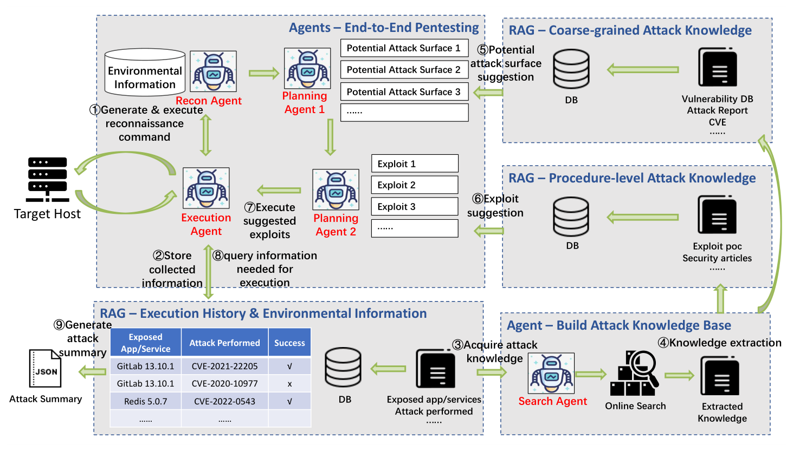
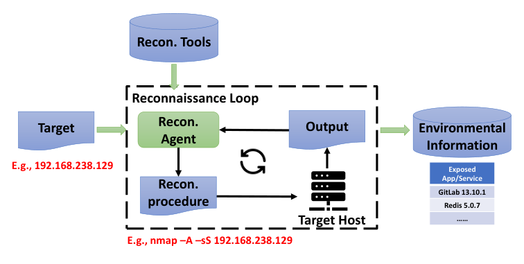
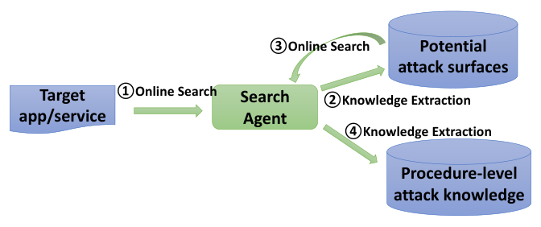
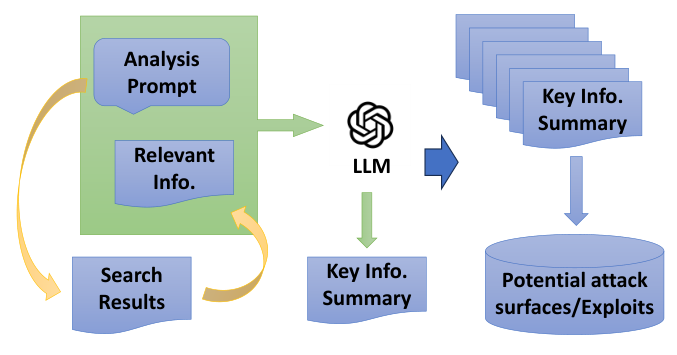
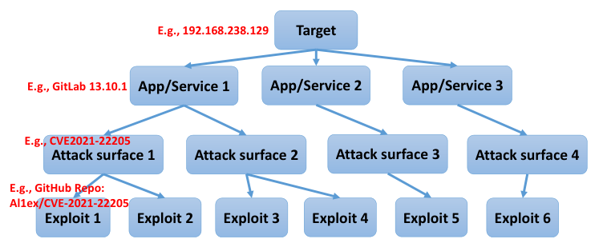
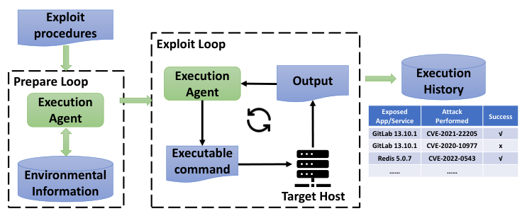
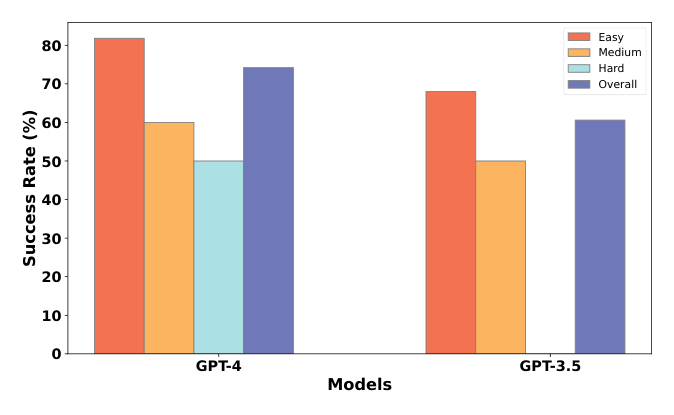
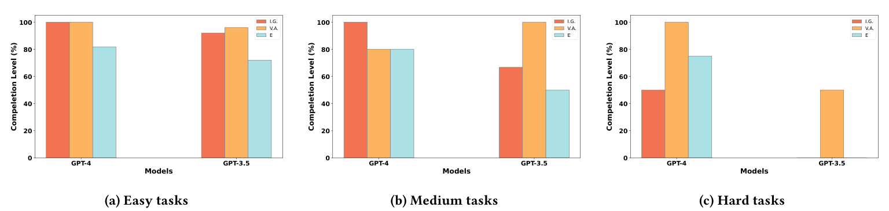
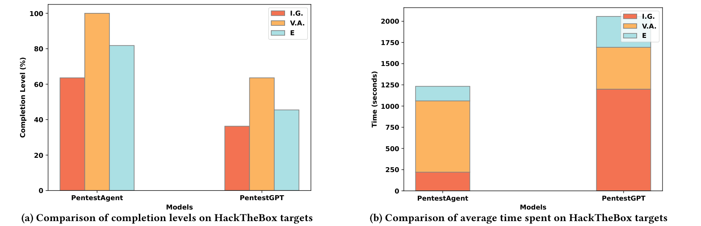

## 一句話摘要

PentestAgent 讓四個 LLM agent 分工完成滲透測試的「偵察 → 漏洞分析 → 漏洞利用」，並自動上網搜尋 CVE 與 exploit、存成知識庫，補足 LLM 本身資安知識的不足；在 67 個 VulHub 漏洞環境上，使用 GPT-4 時整體成功率為 74.2%（§4.2）。

## 1. 問題與動機

**背景：** 滲透測試（penetration testing）是在攻擊者動手之前，先模擬攻擊來找出系統漏洞。標準流程分三個階段：先**情報蒐集**（找出目標開了哪些服務、版本是什麼），再**漏洞分析**（這些版本有哪些已知漏洞、有沒有可用的攻擊程式），最後**漏洞利用**（實際執行攻擊，確認漏洞真的能被打進去）。這篇論文想讓這三個階段都由 LLM 自動完成。

- **人工滲透測試又貴又慢。** 根據 Rapid7 的報告，一次滲透測試平均要 80 小時，複雜的甚至要幾百小時，而且需要經驗豐富的專家，大多數組織負擔不起（§1）。
- **早期的自動化方法多停在理論。** 過去的研究把攻擊規劃建模成 attack graph、MDP（馬可夫決策過程，把攻擊看成「狀態 → 動作 → 下一個狀態」的序列）或強化學習問題。這些方法能算出「理論上該怎麼攻擊」，卻沒有真的去執行，也無法在攻擊失敗時即時調整（§1, §2.1）。
- **現有 LLM 方法仍需大量人工。** PentestGPT 會列出待辦任務樹，但下一步做什麼要由人決定，而且容易卡在單一任務上；AutoAttacker 只處理「已經入侵之後」的階段，前面的偵察與找漏洞沒處理（§2.1, Table 1）。

作者整理出把 LLM 直接用在滲透測試上的**三個核心挑戰**（§2.2），後面的設計都是在回應這三點：

- **C1 知識不足：** LLM 只知道訓練資料裡的通用資安知識。論文示範問 GPT-4「ActiveMQ 5.17.3 有什麼漏洞、怎麼測」，它只回答「保持更新、查 CVE、用掃描工具」這類空泛建議，給不出具體的 CVE 編號和可用的 exploit。
- **C2 短期記憶：** 滲透測試要跨很多步驟，但 LLM 的 context window 有限，前面的資訊會被「忘掉」。結果包括：
    - **重複做事**：在漏洞分析階段又要求重新跑一次 Nmap 全埠掃描。
    - **遺失脈絡**：偵察時已經知道目標 IP 和作業系統，到利用階段卻反問「請提供目標的 IP 和 OS」。
- **C3 工作流整合：** 多個階段要串成自動化流程，LLM 的輸出必須是下游程式能解析的格式，品質也要可靠；同時每個階段要記得自己的工作狀態，例如 exploit 執行到第幾步。

## 2. 貢獻

- **PentestAgent 框架：** 一個幾乎不需人工介入、端到端的自動化滲透測試系統。用**多代理人分工**加上**線上搜尋＋RAG 知識庫**，回應 C1（知識不足）與 C2、C3（記憶與流程整合）。
- **滲透測試 benchmark：** 以 VulHub（現成的漏洞 Docker 環境集合）為基礎，建立 67 個附難度標記的測試目標，另外加入 11 台 HackTheBox 機器作為實務測試（§4.1.1）。作者指出過去缺少容易架設、又有難度分級的公開 benchmark。
- **階段層級的評估方法：** 除了「整體成功率」，再分別量測偵察、漏洞分析、利用三個階段各自的完成度，能看出系統卡在哪個階段（§4.1.2）。
- **開源：** 框架與 benchmark 資料集公開在 GitHub。

## 3. 方法

PentestAgent 由四個 agent 組成，每個 agent 只負責流程中的一段；agent 之間不直接對話，而是透過**資料庫**交換資訊。資料庫就是整個系統的「長期記憶」，這正是用來解決 C2 短期記憶問題的關鍵（§3.1）。



**怎麼看這張圖：** 圖中帶圈的數字 ①～⑨ 就是執行順序。左上的大框是負責「實際動手」的 agent（Recon、Planning 1／2、Execution）；右側兩個框是**知識庫**，上面放「粗粒度」知識（有哪些漏洞、CVE），下面放「程序層級」知識（具體 exploit 程式與教學文章）；右下是負責上網找資料、建立知識庫的 Search Agent；左下是記錄**環境資訊與執行歷史**的資料庫。

用論文的例子把流程走一遍：

1. **①②** Recon Agent 對 Target Host 產生並執行偵察指令，發現它跑著 GitLab 13.10.1，把結果存進左下的環境資訊資料庫。
2. **③④** Search Agent 從資料庫讀到「GitLab 13.10.1」，上網搜尋相關漏洞與攻擊程式，萃取重點後存進右側知識庫。
3. **⑤** Planning Agent 1 從知識庫找出可能的攻擊面（attack surface），例如 CVE-2021-22205。
4. **⑥** Planning Agent 2 再為這些攻擊面挑出具體的 exploit，排好嘗試順序。
5. **⑦⑧** Execution Agent 依序執行 exploit；需要目標 IP、埠號等參數時，回頭查詢環境資料庫。
6. **⑨** 所有嘗試（哪個服務、用了哪個 CVE、成功與否）都記錄下來，最後產生 JSON 格式的攻擊摘要報告。

四個 agent 共用幾個 prompt 技巧（§3.2）：

- **Role-play（角色扮演）**：讓 LLM 扮演「滲透測試助理」，一方面讓它清楚自己的任務，另一方面也降低它因安全政策拒絕執行的機率。
- **Chain-of-Thought（CoT，逐步推理）**：把大任務拆成固定步驟，例如「先用 Nmap 找開放埠，再針對每個埠深入分析」，順便規定什麼時候該停止，避免 agent 無限循環。
- **RAG**：需要知識時先查資料庫，而不是只靠 LLM 的記憶。
- **Structured Output（結構化輸出）**：一律要求回傳固定欄位的 JSON，讓下一個程式模組能直接解析，對應 C3。

### Reconnaissance Agent：偵察



**怎麼看這張圖：** 輸入是左邊的目標 IP（例如 192.168.238.129）。虛線框是「偵察迴圈」：Recon Agent 產生一個偵察指令（紅字範例 `nmap -A -sS 192.168.238.129`）→ 對目標主機執行 → 讀取輸出結果 → 再決定下一個指令，一直循環。上方的 Recon. Tools 是工具說明文件庫，agent 可以查詢「有哪些偵察工具、怎麼用」。迴圈結束後，結果整理成右邊的表格（例如 GitLab 13.10.1、Redis 5.0.7），存入環境資訊資料庫。

- **輸入／輸出：** 輸入目標位址，輸出「目標上有哪些服務與版本」的摘要（§3.2）。
- **為什麼要迴圈：** 偵察不是一個指令就能完成。先掃到開了 80 port，才會進一步辨識上面跑的是哪個網頁應用；每一步都依賴上一步的結果。
- **怎麼避免無限循環：** 用 CoT 在 prompt 裡列出「完成哪些項目就可以停止」，等於替迴圈設定結束條件。
- **怎麼用上新工具：** 透過 RAG 查詢工具文件庫，例如用 ObserverWard 這類網頁指紋辨識工具識別 web 應用，不必只靠 LLM 記得的工具。
- **怎麼解決遺忘：** 偵察結果在迴圈結束時存入資料庫，後面的 agent 隨時可以查，不用全部塞在對話紀錄裡。

### Search Agent：上網找漏洞知識



**怎麼看這張圖：** 這張圖的重點是「搜尋兩輪、存成兩個資料庫」。①② 是第一輪：拿目標服務（如 GitLab 13.10.1）上網搜尋，萃取出「可能的攻擊面」存到上方資料庫。③④ 是第二輪：拿第一輪找到的攻擊面（如 CVE-2021-22205）再搜尋一次，這次找的是「具體怎麼攻擊」，存到下方的程序層級知識庫。

- **為什麼分兩輪（階層式搜尋）：** 直接搜「GitLab 怎麼打」得到的資料太雜。先確定有哪些 CVE，再針對每個 CVE 找 exploit，結果會精準得多（§3.3）。
- **兩輪搜尋的來源不同：**
    - **第一輪找漏洞：** Google 加上漏洞資料庫，例如 Snyk、AVD。
    - **第二輪找攻擊程式：** Google 加上程式碼庫，例如 GitHub、ExploitDB。
- **兩輪用到的 LLM 能力也不同：** 第一輪主要是**摘要文字**，判斷「這篇文章是不是在講這個版本的漏洞、CVE 編號是什麼」；第二輪主要是**讀程式碼**，判斷「這個 GitHub repo 是不是可用的 exploit、需要什麼前置條件、適用哪些版本」。

搜尋結果很長、很雜，不能原封不動存進資料庫，所以 Search Agent 會先用 RAG 萃取重點：



**怎麼看這張圖：** 黃色箭頭是「檢索」，綠色箭頭是「生成」。對每一份搜尋結果（左下 Search Results），先用 Analysis Prompt 裡的問題（例如「這份文件描述的是哪個服務哪個版本的漏洞？」）去檢索文件中的相關段落（Relevant Info.），再把問題加上相關段落一起交給 LLM，產生一份 Key Info. Summary。每份文件各有一份摘要，全部匯集後才存進知識庫。

- **好處：** 知識庫裡存的是精簡過、跟目標相關的重點，之後檢索更準，也省 token（§3.3）。

萃取出的知識會存成樹狀結構：



**怎麼看這張圖：** 由上往下是「目標 → 服務 → 攻擊面 → exploit」四層。紅字是論文的例子：目標 192.168.238.129 上有 GitLab 13.10.1，它有攻擊面 CVE-2021-22205，對應的 exploit 是 GitHub 上的 `Al1ex/CVE-2021-22205`。一個服務可以有多個攻擊面，一個攻擊面也可以有多個 exploit。

- **為什麼用樹狀：** 查詢時可以「沿著樹往下走」，先依服務版本找攻擊面，再依攻擊面找 exploit，管理和檢索都很直觀。
- **多個 exploit 的好處：** 第一個 exploit 失敗時，可以換同一個漏洞的下一個 exploit 再試（§4.7）。

### Planning Agent：決定攻擊順序

Planning Agent 拿偵察到的服務當查詢鍵，到知識庫裡分兩步規劃（§3.4）：

1. **挑攻擊面：** 依服務的**版本**與**漏洞類型**，從粗粒度知識庫取出可能的攻擊面，依漏洞類型分類。
2. **挑 exploit：** 用攻擊面去查程序層級知識庫，依**版本是否相符**和 **exploit 的效果**排序。效果指的是打成功後能得到什麼，例如遠端程式碼執行（RCE）、繞過驗證。

輸出就是一份「先試哪個、再試哪個」的 exploit 清單，交給 Execution Agent 依序執行。

### Execution Agent：實際執行 exploit



**怎麼看這張圖：** 左邊的 Prepare Loop 是「準備階段」：Execution Agent 和環境資訊資料庫來回溝通，把 exploit 需要的參數補齊。中間的 Exploit Loop 是「利用階段」：產生可執行指令 → 打向目標 → 讀輸出 → 決定下一步，和偵察迴圈的結構相同。右邊的 Execution History 記錄每次嘗試的結果，例如 GitLab 13.10.1 用 CVE-2021-22205 成功（√）、用 CVE-2020-10977 失敗（x）。

- **準備階段（§3.5）：** 先用 CoT 讓 agent 回答兩個問題：「這個 exploit 需要哪些參數？」「每個參數需要什麼資訊？」例如需要目標 IP、port、GitLab 版本。接著查環境資料庫把值填進去。這就解決了 C2 提到的「到利用階段才反問 IP」的問題。
- **利用階段：** 用 RAG 讀取 exploit 的 README 與程式碼，產生一步一步的執行指令並實際執行。
- **遇到錯誤怎麼辦（Self-reflection）：** 執行失敗時，agent 會分析錯誤訊息和程式碼，嘗試修正（例如改參數、補裝套件、多執行一個指令收集資訊），並把錯誤記到歷史中，避免重複犯同樣的錯。
- **避免無止盡除錯（§4.7）：**
    - temperature 設為 0，降低輸出的隨機性。
    - 執行次數設硬性上限。
    - prompt 裡規定「看到相同錯誤就停止」。

## 4. 實驗

### 設定

作者想回答三個研究問題：**RQ1** 整個流程自動完成的成功率多高？**RQ2** 各階段分別能完成多少？**RQ3** 要花多少時間和 API 費用？（§4）

- **VulHub benchmark：** 67 個 Docker 漏洞環境，涵蓋 32 種 CWE 漏洞類型、OWASP Top 10 中的 8 類；依 CVSS 的 exploitability 分數分為 50 個 easy、11 個 medium、6 個 hard（§4.1.1）。
    - VulHub 的每個環境大多對應一個 CVE，用 Docker 一鍵架設，方便重現。
    - 環境的 EPSS 分數平均 79.58、中位數 97.19，代表挑的都是真實世界很可能被利用的漏洞（Appendix B）。
- **HackTheBox：** 11 台機器（9 easy、1 medium、1 hard），比 VulHub 更接近真實情境；成功的定義是取得目標的初始存取權（initial access）（§4.1.2, §4.5）。
- **測試環境：** 受害端 VM 為 2 CPU、8 GB RAM、Ubuntu 22.04；攻擊端為 Kali Linux 2024.1、16 CPU、16 GB RAM，只使用 Kali 預裝的工具（§4.1.3）。
- **使用的 LLM：** GPT-3.5-turbo-0125、GPT-4o、o1-mini、Llama 3.1-8B-Instruct（開源模型）（Table 2）。
- **評估指標（§4.1.2）：**
    - **成功率：** 給定目標 IP，系統能否自動跑完三個階段並成功執行 exploit。
    - **階段完成度：** 在「前一階段已經成功」的前提下，各階段分別是否完成。I.G.（情報蒐集）的完成條件是正確辨識出目標應用；V.A.（漏洞分析）是找到可用的 exploit，這一步由人工驗證；E（漏洞利用）是自動成功執行 exploit。
    - **效率：** 每個目標花費的時間與 API 費用。

### 結果

**RQ1：整體成功率**



**怎麼看這張圖：** 左右兩組分別是 GPT-4 和 GPT-3.5；每組四根柱子依序是 easy、medium、hard 和整體（Overall）的成功率。最重要的是紫色的 Overall，GPT-4 約 74%、GPT-3.5 約 61%；GPT-3.5 在 hard 那一根是空的，代表 0%（Fig. 7）。

- **GPT-4 整體成功率 74.2%，GPT-3.5 為 60.6%**（§4.2）。兩者差距不到 14 個百分點，作者認為這代表系統的效果主要來自框架設計（搜尋＋知識庫），而不是只靠模型本身夠強（§4.2）。
- **難度越高越難：** GPT-4 從 easy 約 82% 降到 hard 約 50%；GPT-3.5 在 hard 完全沒有成功（§4.2, Fig. 7）。作者推測原因是 GPT-3.5 的 context window 較小、知識較舊，難以處理需要複雜推理的任務（§4.2）。

**RQ2：各階段完成度**



**怎麼看這張圖：** 三張小圖分別是 easy、medium、hard；每張圖左組是 GPT-4、右組是 GPT-3.5，三根柱子依序是 I.G.（紅）、V.A.（橘）、E（藍）。讀這張圖時要記得：每根柱子都是「假設前一階段成功」下的完成率，所以可以直接看出**瓶頸在哪個階段**——哪一根最低，就是哪一段最常失敗（Fig. 8, §4.1.2）。

- **GPT-4 在 easy 任務：** I.G. 與 V.A. 都是 100%，E 為 81.8%，失敗都發生在最後執行 exploit 的階段（§4.3）。
- **GPT-4 在 hard 任務：** I.G. 掉到 50%，但 V.A. 約 100%、E 約 75%（§4.3, Fig. 8）。意思是：只要偵察正確，後面大多能成功，**hard 任務的瓶頸在偵察**。
- **GPT-3.5 在 easy 任務：** I.G. 92%、V.A. 96%、E 72%（§4.3）。
- **GPT-3.5 在 medium 任務：** V.A. 仍是 100%，但 I.G. 降到 66.7%、E 降到 50%（§4.3）。
- **GPT-3.5 在 hard 任務：** I.G. 與 E 都無法完成（§4.3）。
- **共同趨勢：** 兩個模型的 V.A. 都很穩定，代表「線上搜尋＋知識庫」這部分設計有效；真正的難點在需要與目標互動、隨機應變的偵察與利用階段（§4.3, Fig. 8）。

**換不同的 LLM（Ablation study）**

作者在 13 個目標的子集（6 easy、5 medium、2 hard）上比較四種模型；只用子集，是因為 GPU 資源不足以讓 Llama 跑完整個資料集（§4.4）。

- **V.A. 四種模型都是 100%**，差異出現在 I.G. 與 E（§4.4）。
- **E 階段 o1-mini 最好**，約 92%；GPT-3.5 與 Llama 3.1-8B 較差，分別約 69% 與 62%（§4.4, Fig. 9）。
- **成本：** GPT-3.5 最便宜，每個目標約 1.1 美元；GPT-4 約 2.6 美元；Llama 免費，但平均耗時約 12,000 秒，遠高於其他模型（Fig. 9）。

**HackTheBox 實務測試與 PentestGPT 比較（RQ3）**



**怎麼看這張圖：** 左圖是完成度，右圖是平均花費時間；兩個系統都使用 GPT-3.5。右圖每根柱子由下往上疊起來，紅色是 I.G.、橘色是 V.A.、藍色是 E，整根高度就是總時間。PentestAgent 總時間約 1,230 秒，PentestGPT 約 2,050 秒；PentestGPT 主要慢在紅色的偵察階段（§4.6, Fig. 10）。

- **HackTheBox 結果：** 11 台中有 6 台三個階段全部完成，包括 Lame、Topology、PC、Blue、Optimum、Legacy（Table 3）。
- **各階段完成台數：** PentestAgent 為 I.G. 7 台、V.A. 11 台、E 9 台；PentestGPT 為 I.G. 4 台、V.A. 7 台、E 5 台（Table 3, Table 4）。
- **時間：** PentestAgent 的 I.G. 花 220 秒，PentestGPT 要 1,199 秒；E 為 172 秒比 364 秒。PentestGPT 只有 V.A. 稍快（§4.6）。PentestGPT 需要人一步步決策與回饋，所以多花了時間。
- **VulHub 上的比較（10 個目標）：** 完成度 I.G. 80% 對 10%、V.A. 100% 對 10%、E 70% 對 30%（Appendix C, Fig. 15）。
    - PentestAgent 的 V.A. 比較慢，698.8 秒對 433.5 秒；作者認為多花的時間換來更準確的漏洞分析（Appendix C, Fig. 16）。

## 5. 限制

### 作者自述

作者在失敗分析中整理出四類失敗原因（§4.7）：

- **偵察粒度不夠細：** Nmap 只能辨識到 Nginx 這一層的網頁伺服器，認不出跑在上面的 PHPMailer、PHPUnit、Ghostscript 等元件，後面自然找不到對應漏洞。作者建議加入專門的網頁元件指紋辨識工具（§4.7）。
- **需要額外的專業知識：** 有些 exploit 需要 LLM 不具備的前提知識。例如 Samba CVE-2017-7494 需要事先知道帳號密碼；JBoss CVE-2017-12149 需要會用 ysoserial 工具產生 Java 反序列化 payload。作者的解法是讓人類專家在任何階段介入協助（§4.7）。
- **需要使用者互動：** 有些攻擊要透過網頁介面手動操作，例如 elFinder CVE-2021-32682 需要建立並上傳壓縮檔，目前的 agent 做不到（§4.7）。
- **幻覺會連鎖放大：** 如果 agent 產生錯誤的指令或參數，它可能誤以為是 exploit 程式本身有 bug，於是一路往錯的方向除錯，永遠無法成功（§4.7）。
- **只處理單一漏洞：** 系統一次只打一個漏洞，不會把多個漏洞串成攻擊鏈。例如先用 SSRF 打進內網應用，再一路提權到 root，這類紅隊情境不在本文範圍內（§5.2）。

### 我的觀察

- [補充] **模型名稱不一致：** 內文和圖表都寫「GPT-4」，但 Table 2 列出的實際模型是 GPT-4o。引用時建議寫「GPT-4o（文中稱 GPT-4）」。
- [補充] **階段完成度不能和成功率直接比：** 階段完成度是在「前一階段已成功」的前提下計算的。所以 hard 任務的 V.A. 是 100%，不代表 hard 任務都找到了漏洞；也不能把三個階段的完成度相乘，當作整體成功率。
- [補充] **V.A. 有人工參與：** 「是否找到可用 exploit」由人工驗證，評估本身並非全自動，可能帶入主觀判斷。
- [補充] **和 PentestGPT 的比較基準不一致：** PentestGPT 需要人操作，而 VulHub 部分由經驗較少的大學生操作、HTB 部分由博士生操作（§4.6）。操作者的能力直接影響 PentestGPT 的表現，兩邊的比較不完全公平。
- [補充] **可能有資料污染：** benchmark 都是已知 CVE，而且挑的是 EPSS 很高、網路上資料很多的漏洞。LLM 可能在訓練時就看過相關 exploit，很難區分系統表現來自「推理」還是「記憶」。
- [補充] **沒有報告重複實驗的變異：** 文中沒有說明每個目標跑了幾次、結果的變異有多大。LLM 系統即使 temperature 為 0，結果也可能不穩定。

## 6. 與我研究的關聯

- **分工方式可以對照：** 它依 PTES 三個階段切分 agent，並用資料庫當 agent 之間的共享記憶，不讓 agent 直接對話。設計自己系統的 agent 分工與狀態管理時，可以拿它當 baseline 比較。
- **評估指標可以借用：** 「階段層級完成度」比單一成功率更能定位系統卡在哪裡，概念上接近 subtask 層級的評估，可以參考它怎麼定義每個階段的完成條件。
- **失敗分類可以參考：** §4.7 的四類失敗（偵察粒度、額外知識、使用者互動、幻覺），可以當作整理自己實驗失敗案例的初始分類，再看有沒有新的類別。
- **兩輪搜尋＋樹狀知識庫值得借鏡：** 「先找 CVE、再找 exploit」的階層式搜尋，以及「同一漏洞存多個 exploit，失敗就換下一個」的做法，可以直接應用在漏洞分析模組。
- [補充] **它沒處理的部分正是差異點：** 它專注在 Docker 單一 CVE 的初始存取，不含提權，也不串接多個漏洞。如果研究的靶機需要「取得 shell → 本機偵察 → 提權」的完整攻擊鏈，這就是可以強調的不同之處。

## 7. 關鍵名詞

| 術語 | 說明 |
|---|---|
| Penetration Testing（滲透測試） | 模擬攻擊者的手法測試系統，在真正被攻擊前找出漏洞 |
| PTES | Penetration Testing Execution Standard，滲透測試流程標準；本文採用其中情報蒐集、漏洞分析、漏洞利用三個階段 |
| I.G. / V.A. / E | 本文對三個階段的簡寫：Intelligence Gathering、Vulnerability Analysis、Exploitation |
| Attack surface（攻擊面） | 系統中可被攻擊的入口；本文多指某個服務版本的特定 CVE |
| Exploit | 利用某個漏洞的攻擊程式或步驟，例如 GitHub 上針對某 CVE 的 PoC 程式 |
| CVE | Common Vulnerabilities and Exposures，公開漏洞的統一編號，例如 CVE-2021-22205 |
| CWE | Common Weakness Enumeration，漏洞「類型」的分類，例如 SQL injection、反序列化 |
| CVSS | 通用漏洞評分系統；本文用其中的 exploitability 分數區分 easy、medium、hard |
| EPSS | 預測漏洞在真實世界中被利用機率的分數，越高代表越常被攻擊者使用 |
| LLM Agent | 能使用工具（執行指令、搜尋網路、查資料庫）並根據結果決定下一步的 LLM 系統 |
| RAG | Retrieval-Augmented Generation，先從資料庫檢索相關內容，再連同問題交給 LLM 回答，讓回答有外部知識依據 |
| Chain-of-Thought（CoT） | 引導 LLM 按步驟推理；本文也用它來規定迴圈的停止條件 |
| Self-reflection | 讓 LLM 分析自己的錯誤並記錄下來，之後避免重犯 |
| VulHub | 開源的漏洞 Docker 環境集合，每個環境通常重現一個 CVE，可一鍵架設 |
| HackTheBox | 線上滲透測試練習平台，提供需要實際攻破的靶機 |

## 8. BibTeX

```bibtex
@inproceedings{shen2025pentestagent,
  title     = {PentestAgent: Incorporating LLM Agents to Automated Penetration Testing},
  author    = {Shen, Xiangmin and Wang, Lingzhi and Li, Zhenyuan and Chen, Yan and
               Zhao, Wencheng and Sun, Dawei and Wang, Jiashui and Ruan, Wei},
  booktitle = {Proceedings of the ACM Asia Conference on Computer and Communications Security (ASIA CCS '25)},
  year      = {2025},
  address   = {Hanoi, Vietnam},
  publisher = {ACM},
  doi       = {10.1145/3708821.3733882}
}
```
